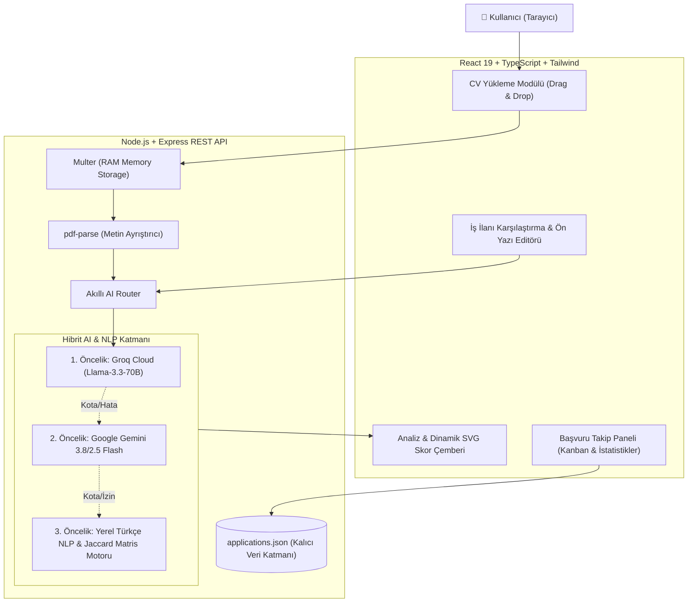

# 🎯 Başvur.AI — Akıllı İş Başvuru ve ATS Uyum Asistanı
### *Y Combinator (Summer 2026) — Tsenta Klonu & Türkiye Yerelleştirmesi*

[](https://react.dev/)
[](https://www.typescriptlang.org/)
[](https://nodejs.org/)
[](https://tailwindcss.com/)
[](https://groq.com/)
[-FF6600?logo=ycombinator&logoColor=white)](https://www.ycombinator.com/companies/tsenta)

> **Proje Amacı:** Y Combinator S2026 mezunu **Tsenta** (AI Career Agent) ürününün mimarisini temel alarak geliştirilmiş, Türk iş piyasasına (Kariyer.net, İŞKUR, LinkedIn TR) uyarlanmış ve sıfır kesintili **Hibrit LLM/NLP Motoru** ile zenginleştirilmiş yeni nesil bir iş başvuru asistanıdır.

---

## 💡 Tsenta Nedir & Başvur.AI Neyi Çözer?

**Tsenta (YC S2026)**, iş arayanların haftalarca süren form doldurma, CV uyarlama ve ön yazı yazma iş yükünü ortadan kaldıran bir *"AI Action Agent"* girişimidir.

**Başvur.AI** bu vizyonu alarak şu 4 temel adımı otomatikleştirir:
1. **📄 Gerçek PDF CV Ayrıştırma:** Yüklenen özgeçmişin metnini arka planda stream buffer üzerinden çözer; beceri, deneyim yılı, eğitim ve iletişim bilgilerini yapılandırılmış veriye dönüştürür.
2. **🎯 ATS Uyum Skoru (Match Score):** Hedef iş ilanındaki gereksinimler ile adayın profilini karşılaştırarak 0–100 arası uyum yüzdesi, eşleşen güçlü yönler ve eksik teknolojileri listeler.
3. **✍️ Kültürel & Parametrik Ön Yazı (Cover Letter):** Türk iş kültürüne uygun 4 farklı üslupta (Profesyonel, Samimi, Özgüvenli, Akademik) şirkete ve ilana özel ön yazı üretir.
4. **📊 Başvuru Takip Paneli (Application Tracker):** Gönderilen başvuruların durumunu (Beklemede, Görüşme, Kabul, Red) istatistiksel metriklerle takip eder.

---

## ⚖️ Orijinal Proje ile Karşılaştırma & Yenilikler (100+ Puan Kriteri)

| Özellik | Tsenta (Orijinal YC S2026) | Başvur.AI (Geliştirilen Sürüm) |
| :--- | :--- | :--- |
| **Odak Pazar** | ABD & Küresel (Greenhouse, Lever, Ashby) | **Türkiye Pazarı (Kariyer.net, İŞKUR, LinkedIn TR, SecretCV, Yenibiris)** |
| **Dil & Morfoloji** | İngilizce ağırlıklı | **Türkçe sondan eklemeli dil desteği & resmi hitap normları** |
| **AI Mimarisi** | Sadece tekil bulut API bağımlılığı | **Çift Katmanlı Hibrit Motor (Groq Llama-3.3-70B + Gemini + Yerel NLP)** |
| **Hata Toleransı** | API kotası biterse servis durur | **API kotası/hata durumunda yerel kural motoruna pürüzsüz geçiş (Sıfır Kesinti)** |
| **Veri Gizliliği** | Üçüncü parti bulut depolama | **Yerel RAM üzerinde geçici PDF analizi (Kişisel veriler dışarı sızmaz)** |

---

## 🏗️ Sistem Mimarisi



---

## 🚀 Kurulum ve Yerel Çalıştırma

### 1. Depoyu Klonlayın
```bash
git clone https://github.com/merve-ciltepe/raindrops.git
cd raindrops
```

### 2. Bağımlılıkları Yükleyin
```bash
npm install
```

### 3. Ortam Değişkenlerini Tanımlayın (`.env`)
Proje kök dizininde `.env` dosyası oluşturun (veya mevcut dosyayı düzenleyin):
```env
# Ücretsiz Groq Anahtarı (Tavsiye Edilen - https://console.groq.com/keys)
GROQ_API_KEY=gsk_...

# Google Gemini Anahtarı (Opsiyonel)
GEMINI_API_KEY=...

PORT=4000
```
> *Not: Herhangi bir API anahtarı eklenmese bile sistem otomatik olarak **Akıllı Yerel NLP Motoru** ile tam kapasite çalışmaya devam eder.*

### 4. Uygulamayı Başlatın
```bash
npm run dev
```
- **Frontend:** [http://localhost:5173](http://localhost:5173)
- **Backend API:** [http://localhost:4000/api/health](http://localhost:4000/api/health)

---

## 🧪 Desteklenen Formatlar & Gereksinimler
- **CV Formatları:** PDF (Metin tabanlı), TXT (Maks. 10MB)
- **Node.js:** v18.0.0 veya üzeri
- **Tarayıcı:** Chrome, Edge, Safari, Firefox
